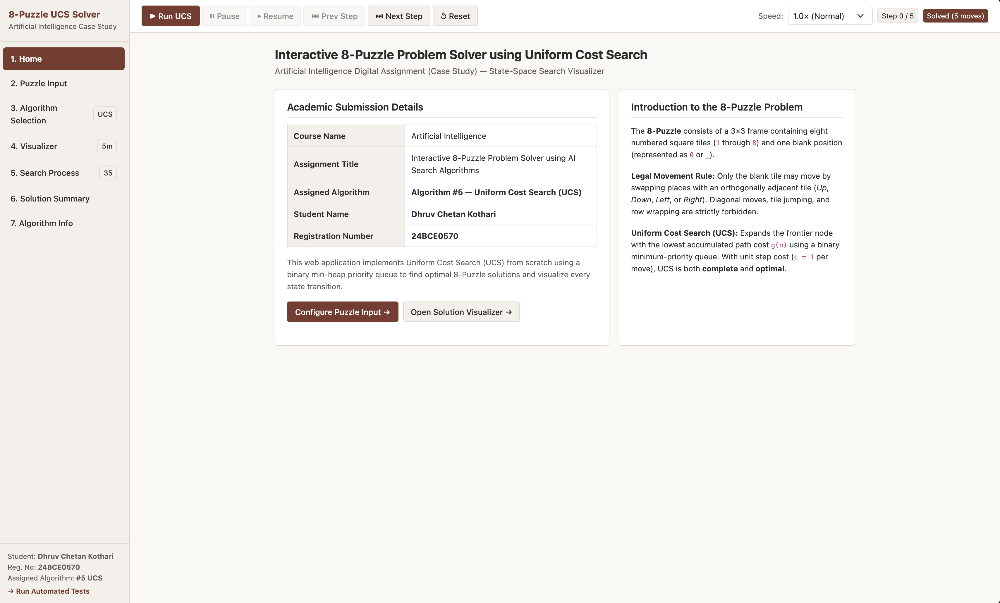
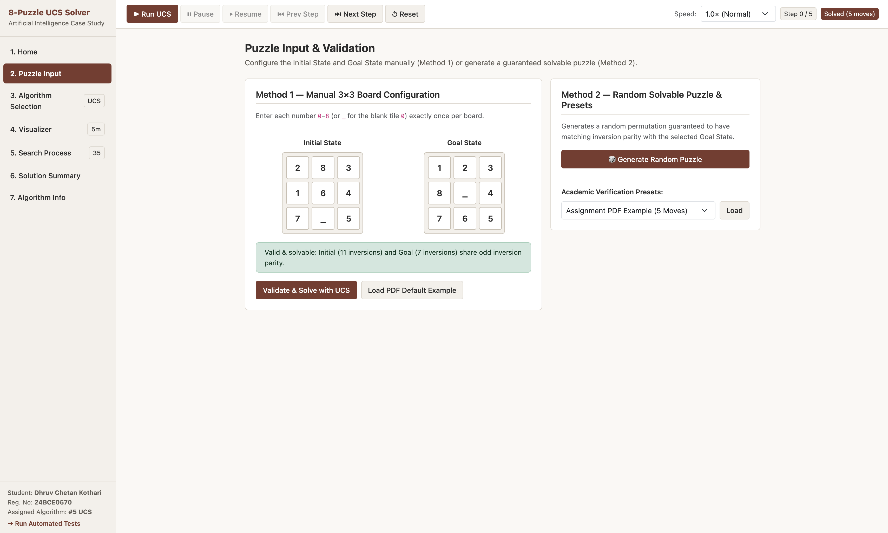
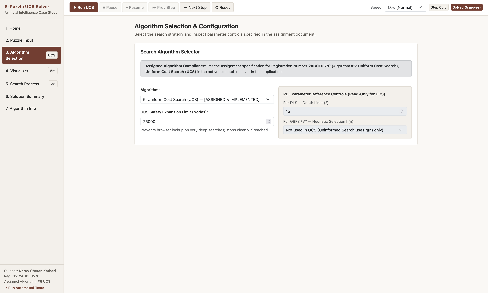
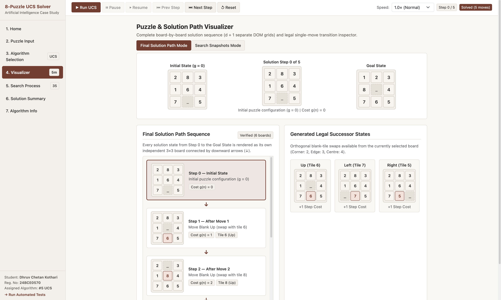
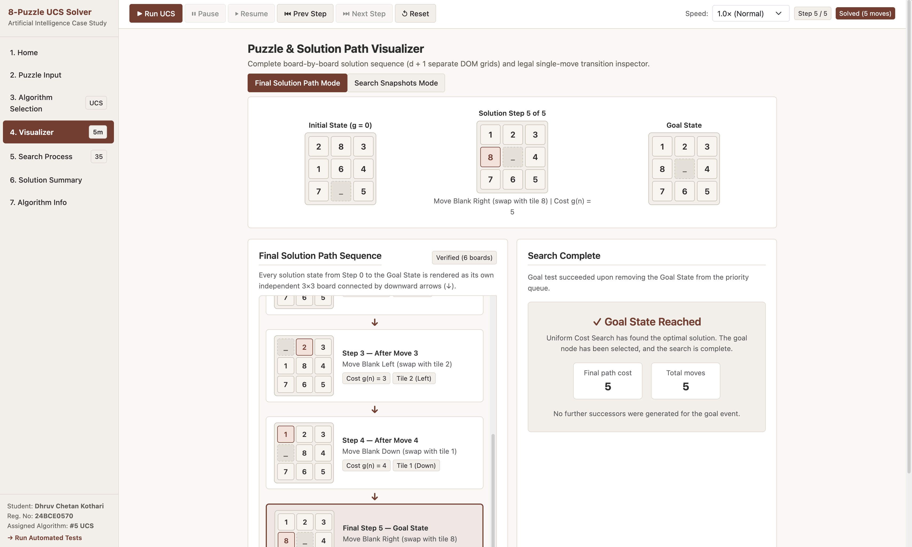
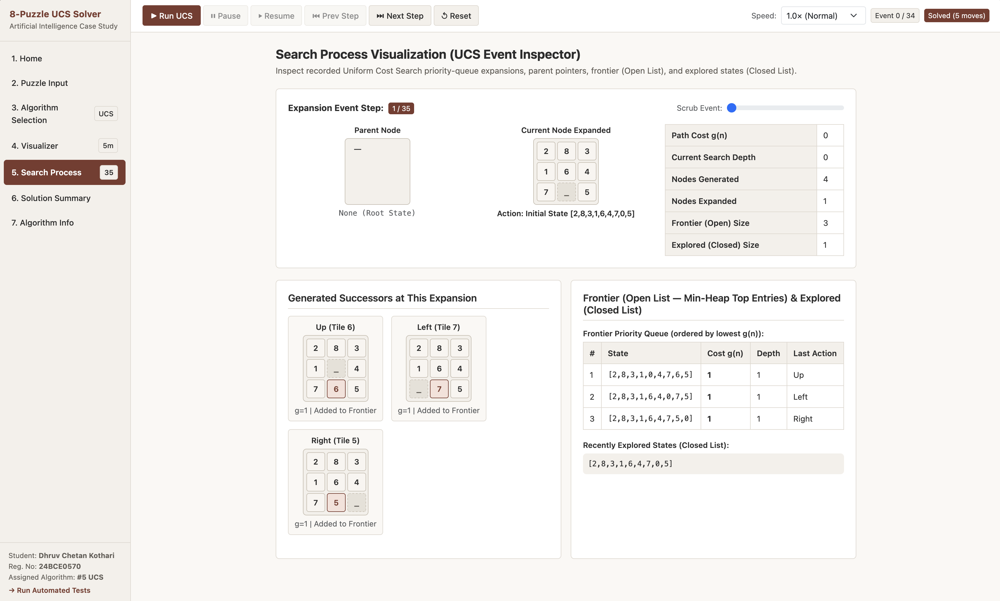
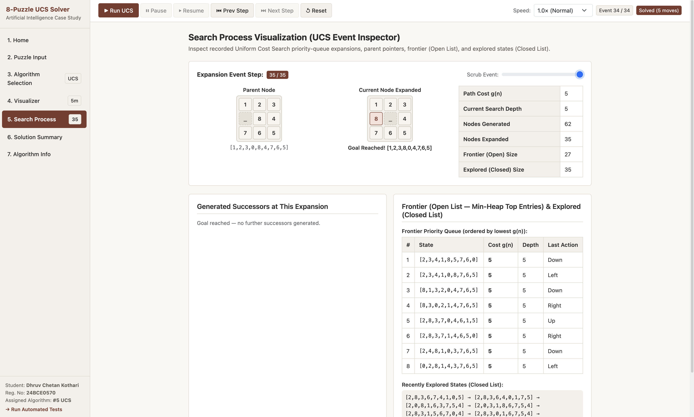
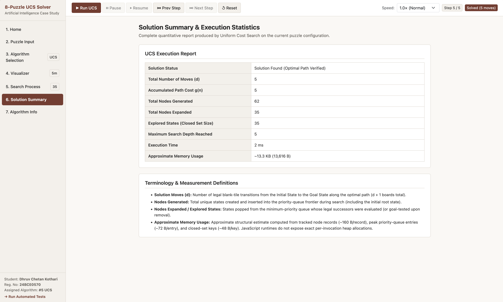
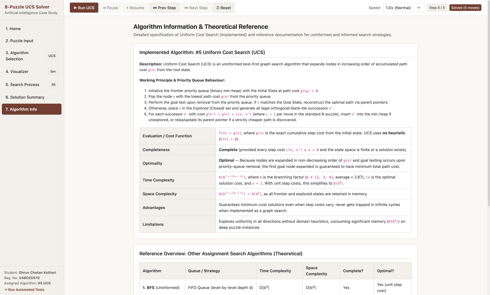
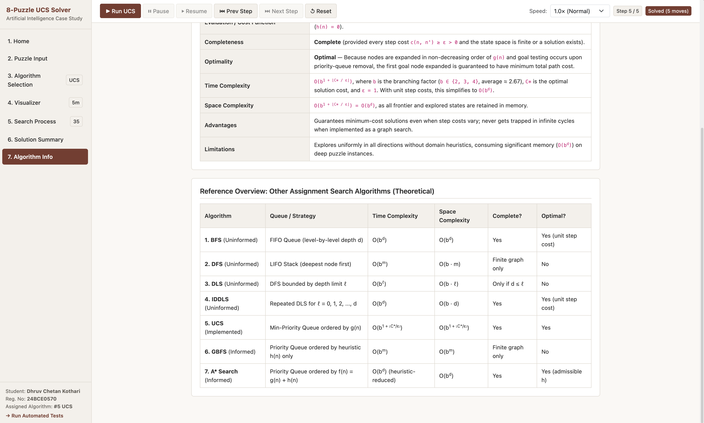

# Interactive 8-Puzzle Solver — Uniform Cost Search (UCS)

An interactive, browser-based 8-Puzzle solver for the Artificial Intelligence digital assignment. The website demonstrates **Uniform Cost Search (UCS)** with a board-by-board solution path, search expansion snapshots, generated legal successors, and solution statistics.

> **Assigned algorithm:** Uniform Cost Search (UCS), Algorithm #5  
> **Student:** Dhruv Chetan Kothari  
> **Registration number:** 24BCE0570

## Project details

| Item | Details |
|---|---|
| Course | Artificial Intelligence |
| Assignment | Interactive 8-Puzzle Problem Solver using AI Search Algorithms |
| Implemented solver | Uniform Cost Search (UCS) |
| Technologies | HTML5, CSS3, JavaScript ES6, Bootstrap 5.3 CSS |
| Deployment  | GitHub Pages |

**Project links**

- **GitHub repository:** https://github.com/DhruvK99/AI-8Puzzle-Visualizer
- **GitHub Pages website:** `ADD_YOUR_GITHUB_PAGES_URL_HERE`

Replace these two placeholders after the repository is created and GitHub Pages is deployed. Do not leave the placeholders in the final submitted README.

## Project description

The 8-Puzzle is a state-space search problem consisting of eight numbered tiles and one blank space arranged on a 3×3 board. The objective is to transform an initial state into a specified goal state by sliding a numbered tile into the adjacent blank space.

This application implements UCS to find a minimum-cost solution. The blank can move only up, down, left, or right by swapping with one immediately adjacent tile. For this project, each move has a cost of 1, and UCS selects the frontier state with the lowest accumulated path cost `g(n)`.

The project focuses on the assigned UCS algorithm. Other algorithms described for educational context are not presented as executable solvers.

## Features

- **Home:** assignment introduction and student details.
- **Puzzle Input:** edit the initial and goal states, load the assignment example or a preset, and generate a random solvable puzzle.
- **Algorithm Selection:** view the assigned algorithm and configure the UCS expansion safety limit.
- **Visualizer:** view each state in the reconstructed solution as its own 3×3 board, connected in sequence and labelled by step and path cost.
- **Search Process:** inspect expansion events, parent and current states, legal successors, frontier/open list, explored/closed information, depth, and path cost.
- **Solution Summary:** view solution status, move count, path cost, generated and expanded node counts, maximum depth, execution time, and approximate memory usage.
- **Algorithm Information:** read about UCS, its working principle, advantages, limitations, completeness, optimality, and complexity.
- **Playback controls:** Run UCS, Pause, Resume, Previous Step, Next Step, Reset, and change playback speed.
- **Responsive navigation:** compact sidebar with a mobile navigation control.
- **Optional automated tests:** a test suite is included for development and verification.

## Solution visualizer and correctness

The Solution Path view renders `d + 1` boards for a solution of `d` moves: the initial board, every intermediate board, and the final goal board. It checks the reconstructed path so that consecutive states represent one legal orthogonal blank-tile swap.

The application also keeps **search expansion order** separate from **solution-path order**. Consecutive nodes expanded by UCS may come from different branches, so the search view presents expansion snapshots rather than implying that every pair of expanded states is one legal move apart.

The application validates the board and checks solvability relative to the selected goal state. A configurable expansion limit helps prevent difficult searches from consuming excessive resources; a search stopped at that limit is reported as limited rather than as a successful solution.

## Search algorithm implemented

The only executable search algorithm in this project is **Uniform Cost Search (UCS)**, the algorithm assigned for this submission. UCS expands the frontier state with the lowest accumulated path cost `g(n)`. Because each move has a unit cost, a successfully completed search returns a minimum-move solution. Other algorithms are not implemented as runnable solvers.

## Technologies used

- **HTML5** — page structure and application views.
- **CSS3** — layout, puzzle boards, navigation and responsive styling.
- **JavaScript ES6** — input validation, legal successor generation, UCS, path reconstruction, search-event recording, rendering and playback.
- **Bootstrap 5.3 CSS** — layout utilities and responsive styling, loaded from jsDelivr CDN.
- **Node.js (optional)** — runs the automated test suite from a terminal.

No backend, database, package manager or build step is required. An internet connection is needed to load Bootstrap CSS from the CDN when using the application.

## Screenshots

The screenshots below were captured from the application. They illustrate the main pages and the search/solution views.

<table>
  <tr>
    <td align="center" width="50%">
      <strong>1. Home</strong><br>
      
    </td>
    <td align="center" width="50%">
      <strong>2. Puzzle Input</strong><br>
      
    </td>
  </tr>
  <tr>
    <td align="center" width="50%">
      <strong>3. Algorithm Selection</strong><br>
      
    </td>
    <td align="center" width="50%">
      <strong>4.1. Solution Path — Start</strong><br>
      
    </td>
  </tr>
  <tr>
    <td align="center" width="50%">
      <strong>4.2. Solution Path — Goal</strong><br>
      
    </td>
    <td align="center" width="50%">
      <strong>5.1. Search Process — Intermediate</strong><br>
      
    </td>
  </tr>
  <tr>
    <td align="center" width="50%">
      <strong>5.2. Search Process — Goal</strong><br>
      
    </td>
    <td align="center" width="50%">
      <strong>6. Solution Summary</strong><br>
      
    </td>
  </tr>
  <tr>
    <td align="center" width="50%">
      <strong>7.1. Algorithm Information</strong><br>
      
    </td>
    <td align="center" width="50%">
      <strong>7.2. Additional Algorithm Reference</strong><br>
      
    </td>
  </tr>
</table>

## How to run the project

Step-by-step local setup instructions are provided in **[`docs/RUNNING_THE_PROJECT.md`](docs/RUNNING_THE_PROJECT.md)**. In brief, extract the project, open a terminal in the folder containing `index.html`, and start a local HTTP server:

```bash
python3 -m http.server 8000
```

Then visit `http://localhost:8000/` in your browser. Windows users can generally use `py -m http.server 8000`. Refer to the linked guide for troubleshooting and optional test instructions.

## Optional automated tests

The project includes a Node.js test runner. If Node.js is installed, run this command from the project root:

```bash
node assets/test_runner.js
```

The suite checks board validation, legal movement rules, UCS behaviour, optimal solution-path reconstruction, unsolvable inputs, random puzzle generation, and resource-limit handling. These tests are a development aid; they are not a substitute for trying the interactive website in a browser.

## GitHub Pages deployment

This is a static website and can be hosted with GitHub Pages.

1. Push the project files to a GitHub repository.
2. Open the repository's **Settings → Pages**.
3. Select **Deploy from a branch**, choose the `main` branch and the repository root (`/`), then save.
4. Wait for deployment to complete and open the generated website URL.
5. Check that the styles and JavaScript load and that the puzzle can be solved on the published site.
6. Replace the GitHub repository and GitHub Pages placeholders near the top of this README with the actual URLs.

The repository page and the live website are different links; the final submission should include both as requested by the assignment.

## Student details

| Field | Details |
|---|---|
| Student name | Dhruv Chetan Kothari |
| Registration number | 24BCE0570 |
| Assigned algorithm | Uniform Cost Search (UCS), Algorithm #5 |
| Course | Artificial Intelligence |

## 10. References

1. **Algorithm Specification:**  
   Stuart Russell and Peter Norvig, *Artificial Intelligence: A Modern Approach* (4th Edition), Pearson. Chapter 3: “Solving Problems by Searching” (Uniform Cost Search, Priority Queues, and Optimality, pp. 75–77).

2. **Puzzle Mathematics (Solvability & Inversion Parity):**  
   Wayne Kelly, “Solvability of the Tiles Game,” *The Mathematical Gazette*. Used for the `countInversions` parity validation to guarantee puzzle solvability before search execution.

3. **UI Framework:**  
   Bootstrap 5.3 Documentation — [https://getbootstrap.com/docs/5.3/](https://getbootstrap.com/docs/5.3/) (utilized for responsive grid layouts, buttons, and form controls).

4. **Web APIs & JavaScript ES6:**  
   MDN Web Docs — [https://developer.mozilla.org/](https://developer.mozilla.org/) (utilized for ES6 data structures like `Set` and `Map`, DOM manipulation, and the `performance.now()` high-resolution timing API for execution metrics).

5. **Project Specification:**  
   Vellore Institute of Technology (VIT), *Artificial Intelligence Digital Assignment (Case Study)*. Used as the primary requirement authority for navigation, visualization constraints, and algorithm locking.

## Scope and limitations

- Uniform Cost Search is the implemented solver for this assigned project.
- For the standard 8-Puzzle, each tile move has unit cost; UCS returns an optimal path under this cost model when it completes successfully.
- Difficult puzzles can reach the configured expansion limit before a solution is found.
- Memory usage is displayed as an approximation, not an exact measurement of all memory used by the browser.
- The website uses Bootstrap CSS from a third-party CDN.
